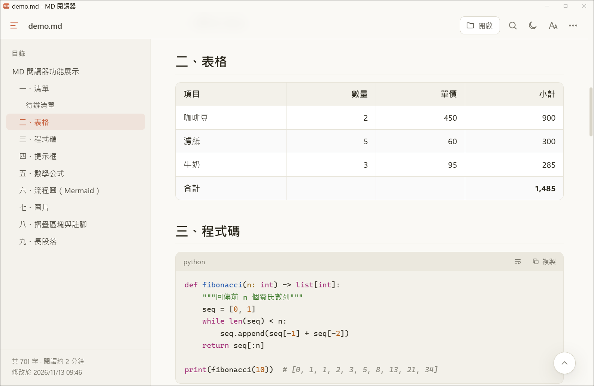
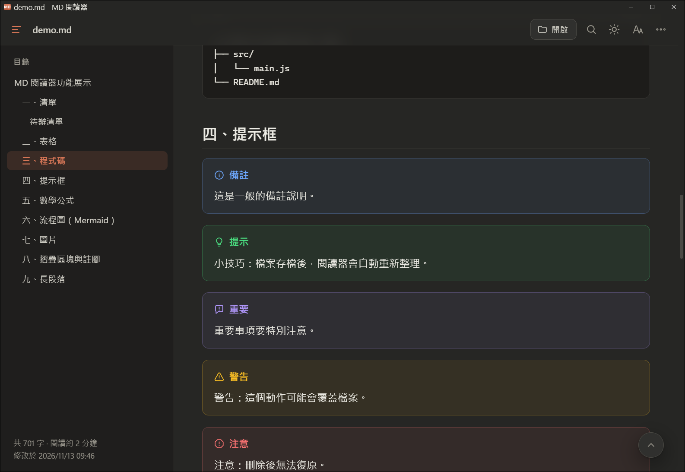

# MD 閱讀器（MDViewer）

把 Markdown（.md）檔案用漂亮、好讀的排版打開的 Windows 小程式。
單一 EXE、不用安裝、不用網路，雙擊就能用。

*A lightweight, single-file Markdown viewer for Windows with a clean reading layout.*



## 下載

到 **[Releases 頁面](https://github.com/HankHsu1969/md-viewer/releases/latest)** 下載 `MDViewer.exe`，放到任何資料夾，雙擊就能用。

如果下載 EXE 被瀏覽器或公司網路擋住，可以改下載同一頁的 `MDViewer.zip`，解壓縮後裡面就是同一個 `MDViewer.exe`。

> **第一次執行看到「Windows 已保護您的電腦」？**
> 這是因為程式沒有購買付費的數位簽章，Windows 不認得它。按「**其他資訊**」→「**仍要執行**」即可。
> 想確認下載的檔案沒有被動過手腳，可以在 PowerShell 執行 `Get-FileHash MDViewer.exe`，和 Releases 頁面上公布的 SHA-256 比對。

## 怎麼用

| 方法 | 說明 |
|---|---|
| 拖曳 | 把 `.md` 檔拖到視窗裡 |
| 開啟 | 按右上「開啟」或 `Ctrl + O` |
| 雙擊 | 設定好預設程式後，雙擊 `.md` 就會用它打開（見下方） |

### 設定成雙擊 .md 就打開

1. 在任何 `.md` 檔上按右鍵 →「開啟檔案」→「選擇其他應用程式」
2. 往下捲到「在這部電腦上選擇應用程式」，選 `MDViewer.exe`
3. 按「一律使用」

> 建議先把 `MDViewer.exe` 放到固定位置（例如 `D:\Tools\`）再設定，之後不要再搬動它。

## 支援的內容

- 標題、粗體、斜體、刪除線、清單、引用
- 表格（自動加框線、斑馬紋）
- 程式碼區塊：自動上色、一鍵複製、可切換自動換行
- 待辦清單 `- [ ]` / `- [x]`
- 提示框 `> [!NOTE]`、`[!TIP]`、`[!IMPORTANT]`、`[!WARNING]`、`[!CAUTION]`
- 數學公式 `$E=mc^2$`、`$$ ... $$`
- Mermaid 流程圖、時序圖（點圖可放大）
- 圖片（相對路徑也可以）、點圖片放大
- 註腳、`<details>` 摺疊區塊、文件開頭的 YAML 資訊



## 好用的功能

- 左側自動目錄，捲到哪裡就亮到哪裡
- 深色 / 淺色模式（預設跟著 Windows）
- 黑體 / 明體、字級大小、標準 / 寬版
- 檔案存檔後會**自動重新整理**（適合邊改邊看）
- 記住每份文件上次讀到的位置
- 搜尋 `Ctrl + F`、列印 `Ctrl + P`、匯出 PDF
- 文件內連到別的 `.md` 會直接在閱讀器裡打開，`Alt + ←` 回上一份

## 鍵盤快捷鍵

| 按鍵 | 功能 |
|---|---|
| `Ctrl + O` | 開啟檔案 |
| `Ctrl + F` / `F3` | 搜尋 |
| `Ctrl + B` | 顯示 / 隱藏目錄 |
| `Ctrl + P` | 列印 |
| `F5` | 重新載入 |
| `Ctrl + +` / `-` / `0` | 放大 / 縮小 / 還原 |
| `Alt + ←` | 回上一份文件 |

## 系統需求

- Windows 10 / 11（64 位元）
- Microsoft Edge WebView2 Runtime（Windows 11 已內建）

程式第一次執行時會把顯示用的檔案放在 `%LOCALAPPDATA%\MDViewer`，不會動到其他地方。

## 隱私與安全

- 不收集任何資料、不需要帳號、沒有廣告。
- 只會讀取你打開的檔案，不會修改它。
- 文件裡的 HTML 會先經過過濾，文件中的程式碼（script）不會被執行。
- 文件裡的網址只會用預設瀏覽器打開；連到其他檔案時只會在檔案總管中標示，不會直接執行。
- 不會開啟指向其他電腦的網路路徑連結（`\\伺服器\...`），避免 Windows 登入憑證外洩。
- 文件裡的**網路圖片預設不會自動載入**（避免寄檔案的人知道你何時開了文件），畫面上方會出現提示，可選「載入這次」或「一律載入」；也可以在「Aa 顯示設定 → 網路圖片」切換。
- 程式不會主動連網；只有你允許載入網路圖片時才會連線。

## 授權

- 本程式以 [MIT 授權](LICENSE) 釋出，可以自由使用、修改、散佈。
- 使用到的開源元件及其授權列在 [THIRD-PARTY-NOTICES.txt](THIRD-PARTY-NOTICES.txt)，程式內「⋯ → 關於 MD 閱讀器」也看得到。

## 自己重新建置

需要 Node.js。在這個資料夾執行：

```powershell
powershell -ExecutionPolicy Bypass -File build.ps1
```

產出 `dist\MDViewer.exe`。

### 資料夾結構

```
MD-Viewer/
├── build.ps1        一鍵建置
├── src/             Windows 主程式（C#，用 Windows 內建編譯器）
├── web/             顯示畫面（HTML / CSS / JS）
├── assets/          圖示
├── docs/            說明用截圖
├── samples/demo.md  功能展示範例
└── dist/            建置結果 MDViewer.exe（不放進 git）
```
