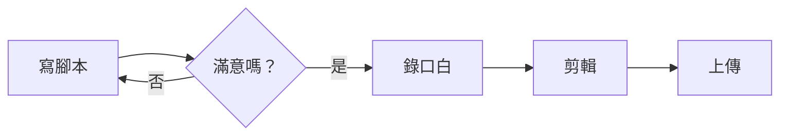
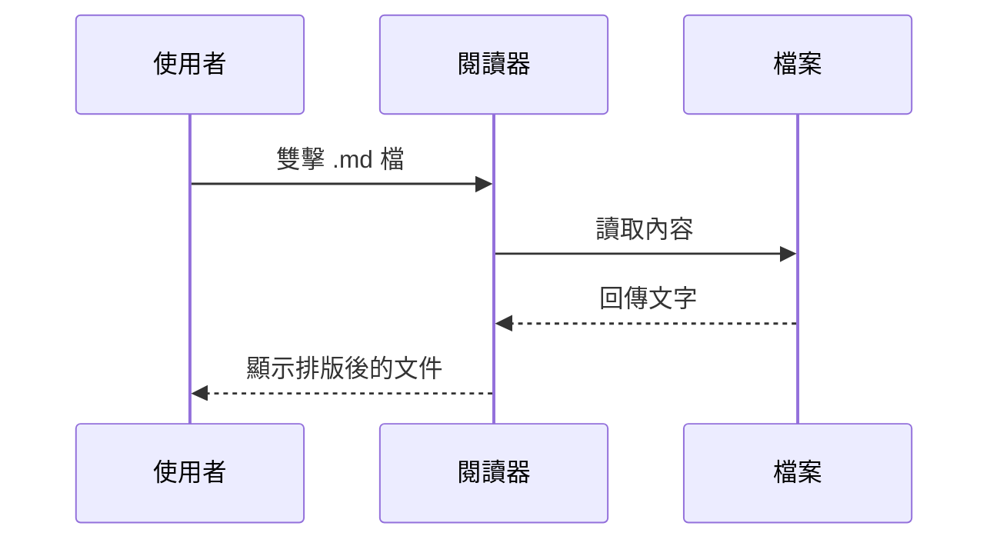

# MD 閱讀器功能展示

這是一份**測試文件**，用來確認各種 Markdown 語法都能正確呈現。包含 *斜體*、~~刪除線~~、`行內程式碼`、[外部連結](https://www.anthropic.com) 以及 <kbd>Ctrl</kbd> + <kbd>O</kbd> 這種按鍵提示。
這一行沒有空行，在「照原文換行」模式下會自動換行。

## 一、清單

- 第一項：一般清單
- 第二項：可以有 **粗體**
  - 巢狀子項目 A
  - 巢狀子項目 B
- 第三項

1. 步驟一：安裝
2. 步驟二：設定
3. 步驟三：執行

### 待辦清單

- [x] 寫好腳本
- [x] 錄好口白
- [ ] 剪輯影片
- [ ] 上傳 YouTube

## 二、表格

| 項目 | 數量 | 單價 | 小計 |
|------|-----:|-----:|-----:|
| 咖啡豆 | 2 | 450 | 900 |
| 濾紙 | 5 | 60 | 300 |
| 牛奶 | 3 | 95 | 285 |
| **合計** | | | **1,485** |

## 三、程式碼

```python
def fibonacci(n: int) -> list[int]:
    """回傳前 n 個費氏數列"""
    seq = [0, 1]
    while len(seq) < n:
        seq.append(seq[-1] + seq[-2])
    return seq[:n]

print(fibonacci(10))  # [0, 1, 1, 2, 3, 5, 8, 13, 21, 34]
```

```javascript
const greet = (name) => `你好，${name}！`;
document.querySelector('#app').textContent = greet('世界');
```

```powershell
Get-ChildItem -Path . -Filter *.md | ForEach-Object { Write-Host $_.Name }
```

```
沒有標語言的區塊會用純文字顯示
├── src/
│   └── main.js
└── README.md
```

## 四、提示框

> [!NOTE]
> 這是一般的備註說明。

> [!TIP]
> 小技巧：檔案存檔後，閱讀器會自動重新整理。

> [!IMPORTANT]
> 重要事項要特別注意。

> [!WARNING]
> 警告：這個動作可能會覆蓋檔案。

> [!CAUTION]
> 注意：刪除後無法復原。

> 這是一般的引用區塊。
> —— 某位名人

## 五、數學公式

行內公式：質能等價 $E = mc^2$，圓面積 $A = \pi r^2$。

區塊公式：

$$
\int_{-\infty}^{\infty} e^{-x^2}\,dx = \sqrt{\pi}
$$

## 六、流程圖（Mermaid）





## 七、圖片


## 八、摺疊區塊與註腳

<details>
<summary>點我展開更多內容</summary>

這裡是被摺疊起來的內容，可以放比較長的說明。

</details>

這句話有一個註腳[^1]，還有另一個註腳[^note]。

[^1]: 這是第一個註腳的內容。
[^note]: 註腳也可以用文字當名稱。

---

## 九、長段落

Markdown 是一種輕量級標記語言，創始人為約翰·格魯伯（John Gruber）。它允許人們使用易讀易寫的純文字格式編寫文件，然後轉換成有效的 HTML 文件。這種語言吸收了很多在電子郵件中已有的純文字標記的特性。由於 Markdown 的輕量化、易讀易寫特性，並且對於圖片、圖表、數學式都有支援，目前許多網站都廣泛使用 Markdown 來撰寫說明文件或是用於論壇上發表訊息。

[回到頂端](#md-閱讀器功能展示)
